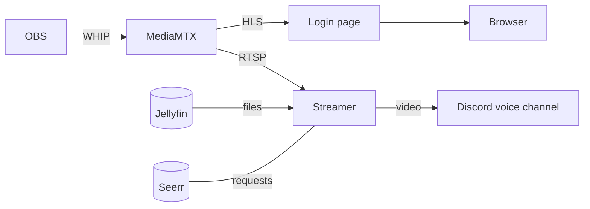

<p align="center"></p>

# Screenarr

Runs the screen in your Discord voice channel.

It streams whatever you are playing in OBS, fills the quiet hours with movies from your Jellyfin library, and takes requests from chat. The same stream also goes to a private web page for anyone who is not on Discord. All of it runs in Docker on a box you already own.



## What people can do

| Command | What happens |
|---|---|
| `/play` | Play anything in the library. If something is already on, it joins the queue. |
| `/random` | Play a random movie. |
| `/shuffle` | Random movies back to back, or one playlist. |
| `/search` | Look something up. |
| `/seek` | Jump to a time. |
| `/request` | Ask for something that is not in the library. Get pinged when it arrives. |
| `/queue` | See, trim or clear what is lined up. |
| `/np` | See what is playing. |
| `/skip` | Skip your own pick, or vote to skip someone else's. |
| `/live` | Go back to the live stream. |
| `/stop` | Stop. |
| `/status` | For admins: uptime, what is connected, recent errors. |

Details and the chat versions are in [docs/COMMANDS.md](docs/COMMANDS.md).

## Read this first

Discord does not let bots send video. The streamer logs in as a regular user account to do it, which is against Discord's terms of service and can get that account banned. Use a throwaway account. Do not use your main.

The library that makes this work speaks Discord's private media protocol. When Discord changes something, it breaks until the library catches up.

## Quick start

You need Docker with compose and a second Discord account that is already in your server. Jellyfin, Seerr and a bot are optional.

```bash
git clone <this repo>
cd screenarr
cp .env.example .env
```

Fill in `.env`. At minimum:

```
HOST_IP=192.168.1.50
GATE_USERS=me:a-password
GATE_SESSION_SECRET=<output of: openssl rand -hex 32>
DISCORD_TOKEN=<user token of the throwaway account>
GUILD_ID=<your server id>
VOICE_CHANNEL_ID=<the voice channel id>
```

Start it:

```bash
docker compose up -d --build
docker compose logs -f streamer
```

Point OBS at it (Settings, Stream):

- Service: `WHIP`
- Server: `http://HOST_IP:8889/live/whip`

Start streaming. The account goes live in the voice channel a few seconds later.

That is the live relay. For slash commands, the library, playlists, requests and the login page, follow [docs/GUIDE.md](docs/GUIDE.md).

## Docs

| File | What is in it |
|---|---|
| [docs/GUIDE.md](docs/GUIDE.md) | Setup, one feature at a time, and troubleshooting. |
| [docs/COMMANDS.md](docs/COMMANDS.md) | Every command. |
| [docs/CONFIGURATION.md](docs/CONFIGURATION.md) | Every setting. |
| [docs/TDD.md](docs/TDD.md) | How it is built and why. |

## Tests

```bash
cd streamer
npm test
```

The tests cover the logic: commands, what plays when, shuffle, the Jellyfin and Seerr clients. They run without Discord or Docker. Nothing tests the Discord connection itself. The only real test for that is going live.
