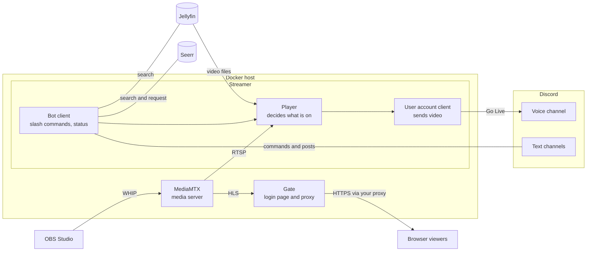
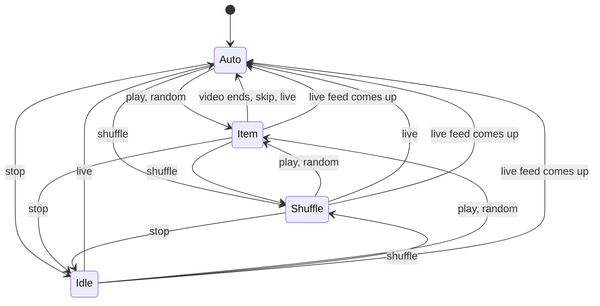
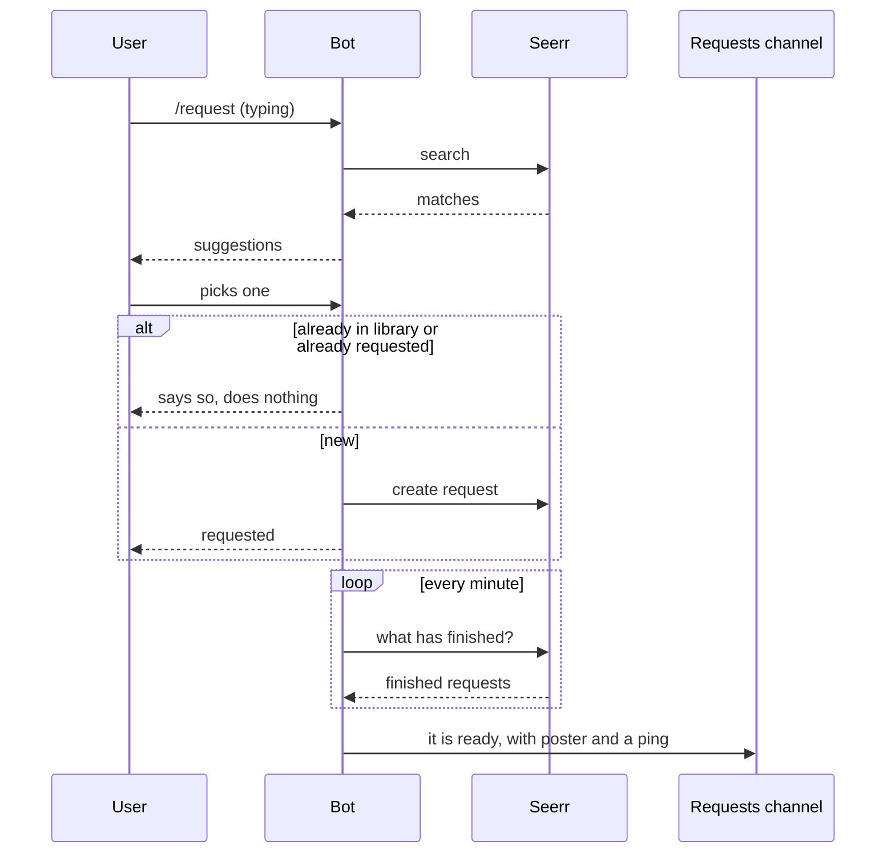

# Technical design

How Screenarr is built and why.

## Goal

Put one screen in a Discord voice channel and keep something on it: a live stream from OBS when there is one, library content when there is not, and whatever people ask for in between. Offer the same live stream on a private web page.

## What it is not

- A media server. Jellyfin stays the library.
- A downloader. Seerr and whatever sits behind it do that.
- Multi channel. One voice channel, one screen.
- A queue. One thing plays at a time.

## Architecture



Three containers, defined in `docker-compose.yml`.

| Container | Job |
|---|---|
| `mediamtx` | Takes one stream in from OBS and serves it as RTSP, HLS and WebRTC. Stock image, configured by environment variables. |
| `gate` | A login page in front of the HLS player. One Node file with no dependencies. Signed cookie sessions, login throttling. |
| `streamer` | Everything Discord. Holds two Discord clients and the player. |

Jellyfin and Seerr are outside the stack and optional.

## Why two Discord clients

Discord does not let bots send video, and does not let user accounts own slash commands. So the streamer runs both:

- A **user account client** joins the voice channel and sends video.
- A **bot client** owns the slash commands, the status and the channel posts.

Keeping commands on the bot means the user account does as little as possible besides stream. That account is the part that breaks Discord's rules, so the less it does the better.

Without a bot, the user account can read `!` commands in one channel instead.

## The player

The player holds one target and keeps the screen matching it.

| Target | Meaning |
|---|---|
| `auto` | The live feed if it is up. Otherwise the idle list, or idle shuffle, or nothing. |
| `item` | One specific library item someone asked for. |
| `shuffle` | Random picks back to back, from all movies or one list. |
| `idle` | Nothing. |



Rules worth knowing:

- **Commands change the target and cancel what is playing.** The loop then resolves the new target. There is one loop and one playback at a time, so there are no races between commands.
- **Live wins on arrival.** A watcher probes the live path every few seconds. On the change from down to up it sets the target to `auto`, which cuts to the stream. It only fires on the change. If the stream was already up when someone picked a movie, the movie stays.
- **A finished item returns to `auto`.** So after a requested movie, the screen goes back to the stream or the idle content on its own.
- **Skip keeps the mode.** In shuffle it picks again. On a requested item it returns to `auto`.

The player takes its dependencies as functions (`play`, `probeLive`, `pickIdle`, `pickShuffle`). It knows nothing about Discord, Jellyfin or ffmpeg, which is what makes it testable.

## Playback

- **Live:** the streamer pulls RTSP from MediaMTX over TCP and re-encodes to H.264 at the configured height, frame rate and bitrate. `NO_TRANSCODE_LIVE` passes the OBS encode through instead.
- **Library:** the streamer asks Jellyfin for the original file (`static=true`), so there is one encode, not two. Movies keep their own frame rate. Seeking restarts playback at an offset.
- The Jellyfin API key goes in a header, never in a URL, so it stays out of logs.

## Shuffle

Plain shuffle and idle shuffle ask Jellyfin for one random item each time.

A named list uses a shuffle bag: load the playlist, shuffle it, deal one at a time, reshuffle when empty. Every item plays once before any repeats, and a new pass never opens with the item that closed the last one. The bag reloads the playlist every 30 minutes and merges changes into the current pass, so edits in Jellyfin show up without a restart.

## Requests



The streamer keeps no file. On startup it reads what Seerr already lists as finished and treats it as old. Anything that appears later is announced once. Who asked for what is held in memory, so the ping does not survive a restart. The announcement does.

## Now playing

The player reports every change. One debounced handler turns the state into a small description (title, state, start, end, poster) and hands it to each target:

| Target | Shows |
|---|---|
| Bot status | "Watching" plus the title. Text only. Discord does not allow images here. |
| Channel card | One embed, edited in place: title, poster, start and end time. |
| User account status | Card with a progress bar, and the poster when an application id is set. |

Posters are the public URLs Jellyfin originally fetched its artwork from. Discord loads images itself and cannot reach a LAN address, so the local copy is no use. Episodes use their show's poster.

A status update that fails is logged once and dropped. It can never interrupt playback.

## The gate

- Sessions are a signed cookie (HMAC-SHA256 over user and expiry). No database.
- Passwords are compared in constant time.
- Eight failed logins per address per ten minutes, then a 429.
- Everything except `/login` and `/logout` needs a session. Page requests get a redirect, media requests get a 401.
- The session cookie is stripped before proxying, so it never reaches MediaMTX.

The gate proxies HLS only. The low delay WebRTC player is for the LAN, since WebRTC media does not pass through most tunnels.

## Security notes

- Only the gate port should be reachable from the internet.
- Jellyfin and Seerr are reached over the LAN.
- The Seerr key is an admin key. Requests through it skip approval and quotas. Limit `/request` with Discord's own permissions.
- Secrets live in `.env`, which is gitignored.
- The user account token gives full control of that account. Use a throwaway.

## Failure handling

| What fails | What happens |
|---|---|
| OBS stops | Playback ends, target stays `auto`, idle content starts or it waits. |
| Jellyfin is down | Logged once. Live still works. Retries on the next pass. |
| A file will not play | Logged, short pause, next pick or back to `auto`. |
| Seerr is down | Logged. Checked again next minute. |
| A status update fails | Logged once and skipped. |
| The streamer crashes | Docker restarts it. It rejoins and resolves `auto`. |

## Code layout

```
gate/server.js            login page and HLS proxy
streamer/src/
  index.js                wiring: clients, player, commands
  config.js               reads settings from the environment
  player.js               what is on screen
  handlers.js             commands, as plain functions
  commands.js             parsing for chat commands and times
  slash.js                slash command definitions and interaction logic
  bot.js                  the bot client
  jellyfin.js             Jellyfin client
  seerr.js                Seerr client
  requests.js             request flow and arrival announcements
  bag.js                  shuffle bag
  presence.js             now playing status and card
streamer/test/run.js      tests
```

The split is deliberate. `index.js` and `bot.js` are the only files that touch Discord. Everything else takes plain objects and functions, so the tests can run it with fakes.

## Testing

`npm test` in `streamer/` runs plain Node tests with no framework. They cover command parsing, the player's transitions, the shuffle bag, both API clients against local fake servers, the request flow, and the status output.

Not covered: the Discord connection, real Jellyfin and Seerr servers, and ffmpeg. Those are checked by running it.

## Known limits

- Depends on a library that reverse engineers Discord's media protocol. It can break without notice.
- One encode per screen in software, on the Docker host. 720p30 is comfortable. 1080p60 wants a real CPU.
- No pause, subtitles, queue or audio track choice.
- Web viewers each pull the full stream bitrate. There is no lower quality rendition.
- Requester pings are lost on restart.
